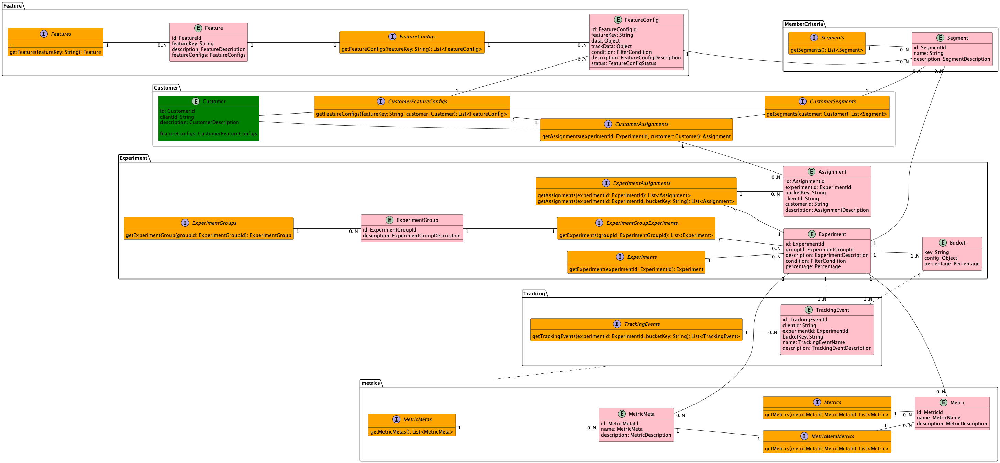

[](https://github.com/pc-dong/ABstract/actions/gradle.yml)

# ABstract
An scaffold project for AB testing 


## TestContainer config
if use colima as test container, you need add the following system environment variables:
```shell
export TESTCONTAINERS_DOCKER_SOCKET_OVERRIDE=/Users/peichao.dong/.colima/docker.sock
export DOCKER_HOST=unix:///{rootpath}/.colima/docker.sock
export TESTCONTAINERS_RYUK_DISABLED=true
```
add them to ~/.bash_profile and add add the follow config to the top of ~/.zshrc
```shell
if [ -f ~/.bash_profile ]; then
   source ~/.bash_profile
fi
```

## 技术栈

编程语言： Java 17

软件构件工具： Gradle 8.1.1

基础框架： Spring Boot 3.X

Web框架：Spring WebFlux、Spring RSocket

数据库： CouchBase + Spring Data reactive CouchBase

测试框架：JUnit5 +  Spring boot test + TestContainer

## 后端服务命令脚本

### 构建

```shell
./gradlew build --no-parallel
```

### 运行测试

```shell
./gradlew test --no-parallel
```

### 本地运行

```shell
# 启动数据库
# docker-compose up -d
# 引入了spring-boot-docker-compose插件，可以直接运行不需要手动启动数据库容器


./gradlew bootrun
```

### Build Image

```shell
./gradlew build
./gradlew npmBuild
docker build -t a_bstract/abstract:latest .
```

## 模型




## C端Rsocket接口RSC脚本示例

RSC是类似与curl命令的RSocket客户端命令行工具，方便对RSocket API进行调试，具体安装使用方法可以查看[GitHub - RSocket Client CLI (RSC)
](https://github.com/making/rsc).

### 1. Request-Stream模式

```shell
> rsc --route=customers.featureConfigs.{featureKey} --stream -m '{"customerId": "111","clientId":"610101","attributes":{}}' --mmt application/json   tcp://localhost:7001
> {"id":"027cc714-d47d-4fd7-b171-7013ffb02a21","featureKey":"{featureKey}","key":"1bd8e02d-7590-4662-86e6-b296a119c9b8","data":{"key1":true,"key2":[""]},"saData":{},"expiredAt":null,"priority":0,"updatedAt":"2023-08-22T17:01:00.497"}
> {"id":"60854696-4cdd-4d3e-bb3c-16447ae37f7d","featureKey":"{featureKey}","key":"7db5c4be-b513-4dcd-8152-7105ce49b08f","data":{"key1":true,"key2":[""]},"saData":{},"expiredAt":null,"priority":0,"updatedAt":"2023-08-22T17:00:58.056"}
> {"id":"fe521c69-6816-4557-ac37-04029925b2ad","featureKey":"{featureKey}","key":"b405968a-f117-459e-acea-63e0f1131489","data":{"key1":true,"key2":[""]},"saData":{},"expiredAt":"2023-08-29T16:00:00","priority":0,"updatedAt":"2023-08-22T17:00:47.004"}
 
```

### 2. Request-Channel模式

```shell
> rsc --route=customers.featureConfigs --channel -m '{"customerId": "111","clientId":"610101","attributes":{}}' --mmt application/json  --data=-  tcp://localhost:7001
> {featureKey}
> {"id":"027cc714-d47d-4fd7-b171-7013ffb02a21","featureKey":"{featureKey}","key":"1bd8e02d-7590-4662-86e6-b296a119c9b8","data":{"key1":true,"key2":[""]},"saData":{},"expiredAt":null,"priority":0,"updatedAt":"2023-08-22T17:01:00.497"}
> {"id":"60854696-4cdd-4d3e-bb3c-16447ae37f7d","featureKey":"{featureKey}","key":"7db5c4be-b513-4dcd-8152-7105ce49b08f","data":{"key1":true,"key2":[""]},"saData":{},"expiredAt":null,"priority":0,"updatedAt":"2023-08-22T17:00:58.056"}
> {"id":"fe521c69-6816-4557-ac37-04029925b2ad","featureKey":"{featureKey}","key":"b405968a-f117-459e-acea-63e0f1131489","data":{"key1":true,"key2":[""]},"saData":{},"expiredAt":"2023-08-29T16:00:00","priority":0,"updatedAt":"2023-08-22T17:00:47.004"}
 
```

## 系统功能

[](https://www.youtube.com/watch?v=VEW3CP06tvs)

### 特性管理

**特性**指被测试软件的某个功能点，通常可以通过对应的配置项控制其表现行为（比如：是否展示/展示素材/控制流程等）。

特性管理模块提供了对特性的增删改查功能，以及基于**模版化**的配置能力。

### 实验管理

提供AB实验生命周期管理，配置主要包括实验分组比例、分组配置（基于特性模版）、实验分组结果统计能力。

### C端接口

实验和和固定配置通过统一接口获取，C端对是否有实验无感。可以顺畅的切换实验到实验后的固定配置。